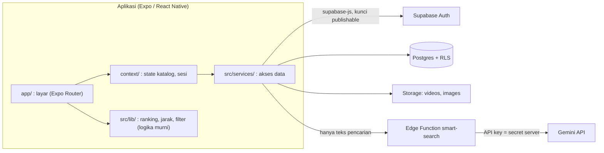
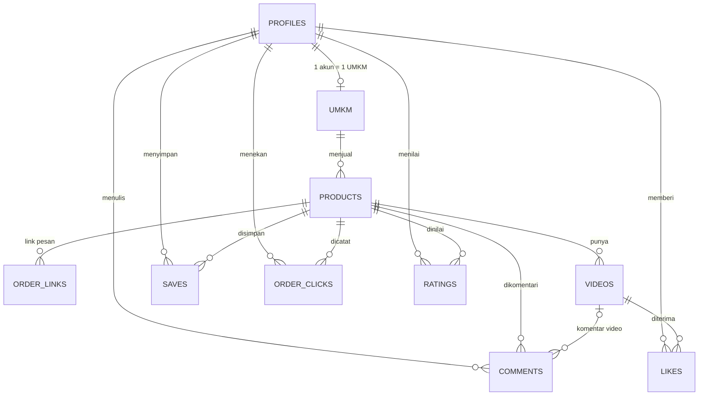
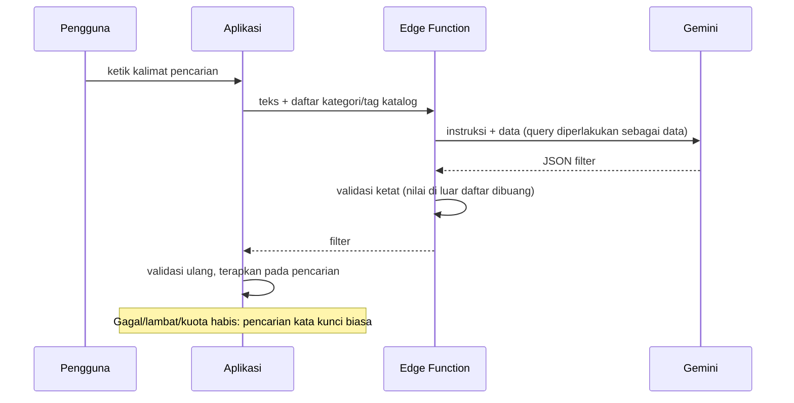

# SaudaGrow

Platform *discovery* UMKM kuliner berbasis **video vertikal pendek**. Pengguna menemukan makanan lewat feed, melihat informasinya, lalu **Pesan** lewat GoFood / GrabFood / ShopeeFood / WhatsApp atau **Lihat di Maps**. Aplikasi **tidak memproses transaksi sendiri**.

Dibuat untuk LOGICODIX 2026 Hackathon, subtema *Local MSME & Creative Economy*. Platform target: Android (React Native / Expo), dengan tampilan web untuk melihat tata letak.

> Status: **MVP lengkap**: seluruh Tingkat A, ditambah lokasi, komentar, rating, Smart Search AI, dan ranking feed. Rincian cakupan, risiko, dan acceptance test ada di [`planRevisi.md`](planRevisi.md); naskah video demo di [`docs/naskah-demo.md`](docs/naskah-demo.md).

## Daftar isi

1. [Latar belakang dan solusi](#1-latar-belakang-dan-solusi)
2. [Fitur dan status](#2-fitur-dan-status)
3. [Arsitektur](#3-arsitektur)
4. [Teknologi](#4-teknologi)
5. [Struktur repositori](#5-struktur-repositori)
6. [Model data](#6-model-data)
7. [Keamanan dan hak akses (RLS)](#7-keamanan-dan-hak-akses-rls)
8. [Fitur AI: Smart Search](#8-fitur-ai-smart-search)
9. [Rekomendasi feed](#9-rekomendasi-feed)
10. [Data yang dicatat dan etika](#10-data-yang-dicatat-dan-etika)
11. [Green IT](#11-green-it)
12. [Instalasi dan menjalankan di localhost](#12-instalasi-dan-menjalankan-di-localhost)
13. [Build APK (EAS)](#13-build-apk-eas)
14. [Pengujian](#14-pengujian)
15. [Batasan yang diketahui](#15-batasan-yang-diketahui)
16. [Sumber aset dan lisensi](#16-sumber-aset-dan-lisensi)

---

## 1. Latar belakang dan solusi

**Masalah.** UMKM kuliner kecil sulit mendapat exposure karena bersaing dengan brand besar, sementara pengguna bingung mau makan apa dan harus mencari lewat banyak platform.

**Solusi.** Feed video vertikal khusus kuliner UMKM. GoFood/GrabFood/ShopeeFood hanya untuk *memesan*; SaudaGrow untuk *menemukan dan melihat dulu* makanannya, lalu mengarahkan ke platform pesan yang sudah dipakai UMKM. Berbeda dengan TikTok/Instagram, isinya khusus kuliner UMKM dan setiap video langsung terhubung ke harga, lokasi, dan tombol pesan.

**Peran pengguna**

| Peran | Bisa apa |
|---|---|
| Tamu | Menonton feed, mencari (termasuk Smart Search), membuka produk, membaca komentar dan ulasan |
| User | Tamu + like, simpan, komentar, **Pesan** (dicatat), rating setelah menekan Pesan, mendaftar sebagai UMKM |
| UMKM (approved) | User + mengelola produk, link pesan, dan video miliknya; melihat statistik dan memoderasi komentar produknya |
| Admin | Menyetujui/menolak UMKM, menghapus komentar dan ulasan yang melanggar. Admin ditetapkan manual di database, bukan lewat aplikasi |

## 2. Fitur dan status

| Kode | Fitur | Status |
|---|---|---|
| A1 | Akun dan peran (`user` / `umkm` / `admin`) | Selesai (email + kata sandi; login Google belum) |
| A2 | Pendaftaran UMKM (data usaha, GPS, logo, legalitas opsional), status `pending` | Selesai |
| A3 | Verifikasi admin satu kali (`approved` / `rejected`) | Selesai |
| A4 | CRUD produk milik UMKM sendiri | Selesai |
| A5 | Link pesan per produk (GoFood, GrabFood, ShopeeFood, WhatsApp) | Selesai (platform "lainnya" ada di database, belum di UI) |
| A6 | Upload video vertikal maks. 60 detik / 50 MB; nama, harga, kategori selalu dari data produk | Selesai |
| A7 | Feed video penuh layar: swipe, putar otomatis yang terlihat, jeda yang tidak terlihat | Selesai |
| A8 | Tombol Pesan membuka link platform dan mencatat klik | Selesai |
| A9 | Tombol Lihat di Maps dari koordinat UMKM | Selesai |
| A10 | Like dan Simpan tersimpan di database | Selesai |
| A11–A12 | Stabilitas, branding, kebersihan repo | Selesai |
| A13 | Build APK Android | Lihat [bagian 13](#13-build-apk-eas) |
| B1 | Lokasi: urut terdekat, jarak, tab FYP "Terdekat" (GPS ditolak tetap bisa dipakai) | Selesai (tanpa pilih manual/kota/radius) |
| B2 | Komentar produk dan komentar video | Selesai |
| B3 | Rating 1–5 + ulasan, hanya setelah menekan Pesan | Selesai |
| B4–B6 | Share, Follow, Watch time | Belum |
| C1 | **Smart Search (AI)** | Selesai |
| C2–C3 | Skor rekomendasi dan diversifikasi feed | Selesai (sinyal yang tersedia; lihat [bagian 9](#9-rekomendasi-feed)) |

## 3. Arsitektur



Prinsip yang dipegang:

- **Layar tidak memanggil Supabase langsung.** Semua akses data lewat `src/services/`; layar hanya memakai state dari context.
- **Keamanan ada di database, bukan di aplikasi.** Aturan siapa boleh membaca/menulis apa ditegakkan oleh Row Level Security, trigger, dan fungsi `security definer`; UI hanya mencerminkannya.
- **Logika murni dipisah** (`src/lib/feedRank.ts`, `searchFilter.ts`, `geo.ts`) agar bisa diuji otomatis tanpa React Native.
- **AI di sisi server.** Kunci Gemini hanya ada di Edge Function sebagai secret; aplikasi tidak pernah memegangnya.
- Hanya kunci **publishable (anon)** yang dipakai di klien. `service_role` tidak ada di aplikasi maupun repo.

## 4. Teknologi

| Lapisan | Teknologi |
|---|---|
| Aplikasi | Expo SDK 57, React Native 0.86, React 19, Expo Router, TypeScript (strict) |
| Video | `expo-video` (satu pemutar aktif untuk slide yang terlihat) |
| Media dan lokasi | `expo-image-picker`, `expo-location`, `expo-file-system` |
| Backend | Supabase: Auth, Postgres (RLS), Storage, Edge Functions (Deno) |
| AI | Google Gemini (dipanggil dari Edge Function) |
| Build | EAS Build (APK) |
| Kualitas | ESLint (`eslint-config-expo`), `tsc --noEmit`, uji logika dengan test runner Node |

## 5. Struktur repositori

```
app/                 Route Expo Router: (tabs)/ Home, Cari, Tersimpan, Profil; product/[id], login,
                     register-umkm, umkm-dashboard, admin
context/             AppContext: katalog, feed berperingkat, like, simpan, Pesan (membaca lewat services)
src/
  config.ts          APP_NAME dan konstanta bersama (batas video, bucket, batas komentar)
  types.ts           tipe bersama
  context/           AuthContext: sesi, profil, peran, data UMKM
  services/          akses data per domain: auth, catalog, engagement, manage, ratings, comments,
                     umkm, storage, location, smartSearch
  lib/               logika dan utilitas: feedRank, searchFilter, geo, supabase (klien), dialog, dll.
  components/        FeedVideo, ProductForm, RatingSection, CommentSection, ProductVideoModal, dll.
  hooks/             useLoginGuard
supabase/
  schema.sql         skema + RLS + view + fungsi + bucket (satu sumber kebenaran; sudah memuat B2 dan B3)
  b2_comments.sql    komentar (aman diulang; untuk database lama)
  b3_ratings.sql     rating (aman diulang; untuk database lama)
  b4_umkm_legal_privacy.sql  perlindungan nomor legalitas (untuk database lama)
  seed*.sql          data contoh untuk pengembangan dan demo
  functions/smart-search/index.ts   Edge Function AI
scripts/             uji logika murni (npm run test:logic)
docs/naskah-demo.md  naskah video demo
planRevisi.md        rencana, cakupan fitur, risiko, acceptance test
eas.json             profil build EAS (preview = APK)
```

## 6. Model data

Hubungan inti: **UMKM → Produk → Video**.



| Objek | Isi |
|---|---|
| `profiles` | Satu baris per akun (dibuat otomatis oleh trigger saat mendaftar): peran, nama tampilan |
| `umkm` | Data usaha, koordinat, logo, `legal_id` (opsional), `status` (`pending` / `approved` / `rejected`) |
| `products`, `order_links`, `videos` | Katalog. Harga/nama/kategori hanya ada di `products`; video selalu mengikutinya |
| `likes` (per video), `saves` (per produk), `order_clicks` | Interaksi pengguna; satu like/simpan per pengguna |
| `ratings` | Bintang 1–5 + ulasan opsional, satu per pengguna per produk |
| `comments` | Komentar produk (`video_id` kosong) dan komentar video (`video_id` terisi) |
| View publik | `video_stats`, `product_stats` (hanya angka), `product_rating`, `umkm_rating`, `product_reviews`, `product_comments`, `product_comment_count`, `video_comments`, `video_comment_count` |
| Fungsi | `is_admin`, `owns_approved_umkm`, `owns_product`, `is_approved_umkm_owner`, `can_comment_on` (pemeriksa hak, `security definer`); `set_umkm_status` (hanya admin); `get_umkm_legal_ids` (pemilik/admin); trigger `handle_new_user`, `sync_profile_role`, `limit_comment_rate` |
| Storage | Bucket `videos` (publik baca; mp4/mov; maks. 50 MB) dan `images` (jpeg/png/webp; maks. 5 MB). Path wajib `{user_id}/{nama-file}` |

## 7. Keamanan dan hak akses (RLS)

Row Level Security aktif di **semua tabel**. Aturan utama (diuji di database, bukan hanya di UI):

| Data | Aturan |
|---|---|
| `profiles` | Hanya terbaca pemilik dan admin; kolom yang boleh diubah hanya `display_name` dan `avatar_url` (peran tidak bisa diubah sendiri) |
| `umkm` | UMKM approved terbaca publik; yang belum approved hanya pemilik dan admin. Status hanya berubah lewat `set_umkm_status` (admin). Kolom `legal_id` (NIB/PIRT) **tidak terbaca publik**: hak SELECT kolom dicabut dan nilainya diambil lewat `get_umkm_legal_ids()` (pemilik: miliknya; admin: semua) |
| `products`, `order_links`, `videos` | Baca publik untuk UMKM approved; tulis hanya pemilik UMKM yang **approved**. UMKM A tidak bisa mengubah data UMKM B |
| `likes`, `saves` | Hanya milik sendiri; publik hanya melihat jumlah lewat view |
| `order_clicks` | Mencatat klik atas nama sendiri (**login wajib**); terbaca pemilik baris, pemilik produk, dan admin |
| `ratings` | Insert hanya bila pengguna pernah menekan Pesan pada produk itu dan bukan pemilik produknya; tabel hanya terbaca pemiliknya dan admin; ulasan publik tampil anonim lewat view |
| `comments` | Atas nama sendiri; teks 1–500 karakter; video harus milik produknya; maks. 5 komentar/menit/pengguna (trigger); dihapus oleh penulis, pemilik produk, atau admin; tidak bisa diedit |
| Storage | Unggah hanya ke folder sendiri; bucket `videos` hanya untuk pemilik UMKM approved |

Catatan jujur: rating dibatasi pada pengguna yang menekan **Pesan**, tetapi itu bukan bukti pembelian karena aplikasi tidak memproses transaksi.

## 8. Fitur AI: Smart Search

Kotak pencarian memahami kalimat bebas, mis. *"makanan pedas murah dekat sini"*. Teks dikirim ke Supabase Edge Function `smart-search`, yang meminta Gemini mengubahnya menjadi filter terstruktur:

```json
{ "kategori": "…", "tag": ["pedas"], "harga_maks": 25000,
  "urut": "termurah", "gunakan_lokasi": true, "kata_kunci": "ayam" }
```

Aplikasi menerapkan filter itu pada pencarian biasa (kategori, tag, harga, jarak, urutan) dan menampilkannya sebagai **chip yang bisa dihapus satu per satu**, dengan label **"Dibantu AI"**.



**Transparansi, privasi, dan etika**

- Yang dikirim ke AI: hanya teks pencarian dan daftar kategori/tag katalog. **Tidak ada** id pengguna, email, ataupun lokasi. Teks pencarian tidak disimpan dan tidak ditulis ke log.
- UI memberi label "Dibantu AI" dan peringatan bahwa hasil AI bisa keliru; pengguna tetap memegang kendali lewat chip.
- Kunci API hanya ada sebagai secret server.
- Ketahanan terhadap penyalahgunaan: teks pengguna diperlakukan sebagai data (bukan instruksi), keluaran model divalidasi di server dan di aplikasi, panjang masukan dibatasi (200 karakter), dan ada pembatas laju (12 permintaan/menit/IP, best effort).
- **Cadangan**: bila AI gagal, lambat (batas 8 detik di server, 10 detik di aplikasi), atau kuota habis, aplikasi otomatis memakai pencarian kata kunci biasa dan memberi tahu pengguna.

Pemasangan fungsi dijelaskan di [bagian 12](#12-instalasi-dan-menjalankan-di-localhost), langkah 7.

## 9. Rekomendasi feed

Urutan feed dihitung **di perangkat** dengan skor sederhana yang bisa dijelaskan (`src/lib/feedRank.ts`):

- **popularitas** (suka + 2 × simpan + 3 × klik Pesan, skala log),
- **kesegaran** video (meluruh ke setengah dalam sekitar 10 hari),
- **jarak** (hanya bila izin lokasi sudah diberikan),
- **kualitas**: rating produk (rata-rata Bayesian dengan prior 3,5 bernilai 3 rating, sehingga satu rating bintang 5 tidak langsung mengalahkan produk yang punya banyak rating), hanya bila produk sudah punya rating,
- **kecocokan kategori** (hanya pengguna yang punya riwayat suka/simpan),
- **penalti sudah ditonton**: video yang sudah tampil di sesi ini dikalikan 0,35 (diturunkan, tidak disembunyikan; riwayat hanya di memori selama aplikasi terbuka).

Sinyal yang tidak tersedia dibuang dan bobot sisanya dinormalkan ulang. Urutan akhir memakai **acak berbobot** (*weighted random sampling*): video berskor tinggi cenderung di depan, tetapi urutannya berbeda setiap refresh. Setelah itu feed **didiversifikasi** agar tidak menampilkan UMKM yang sama berturut-turut.

Urutan hanya dihitung ulang saat aplikasi dibuka atau saat refresh, bukan setiap kali pengguna menyukai sesuatu, agar feed tidak berubah saat sedang digulir.

**Dua halaman FYP.** Tab **Untuk Anda** memakai ranking di atas. Tab **Terdekat** memakai **jarak sebagai bobot dominan (50%)** lalu ranking sebagai pembeda, tanpa pengacakan, sehingga yang terdekat benar-benar di depan. Izin lokasi baru diminta saat tab Terdekat dibuka; bila ditolak, halaman menjelaskan alasannya dan aplikasi tetap bisa dipakai.

**Kontrol feed.** Ketuk video untuk jeda/putar; bilah tipis di bawah video bisa diketuk atau digeser; ketuk tab Home yang sudah aktif, ketuk logo, atau tarik layar dari video pertama untuk refresh; ketuk akun UMKM untuk membuka halaman produk di tab "Tentang UMKM".

Sinyal watch time, follow, dan share belum dipakai karena fiturnya belum dibuat (B4–B6); preferensi harga juga belum dimasukkan.

## 10. Data yang dicatat dan etika

| Data | Isi | Siapa yang bisa membaca |
|---|---|---|
| Akun (`profiles`) | nama tampilan, peran | pemilik akun; admin |
| Daftar UMKM (`umkm`) | data yang diisi saat mendaftar (termasuk nomor legalitas opsional) | UMKM approved dapat dibaca publik **kecuali nomor legalitas**, yang hanya terbaca pemiliknya dan admin. UMKM yang belum approved hanya terbaca pemilik dan admin |
| Like dan simpan | pengguna, video/produk, waktu | pemilik akun; UMKM dan publik hanya melihat jumlah |
| Klik Pesan (`order_clicks`) | pengguna, produk, platform, waktu | pemilik akun, admin, dan pemilik UMKM atas produknya (aplikasi hanya menampilkan jumlah) |
| Komentar | pengguna, produk, video (bila ada), isi, waktu | publik lewat view: isi, waktu, dan **nama tampilan** penulis (id pengguna tidak ditampilkan) |
| Rating dan ulasan | bintang, ulasan opsional, waktu | tabel hanya pemilik dan admin; publik melihat rata-rata dan ulasan **anonim** |
| Pencarian AI | **tidak disimpan**; teks hanya diteruskan ke Gemini | tidak ada |
| Lokasi perangkat pengguna | **tidak dikirim ke server**; dipakai di perangkat untuk jarak dan urutan feed | tidak ada |
| Koordinat UMKM | diisi pemilik saat mendaftar (boleh memakai GPS), ditampilkan untuk fitur Maps | publik (UMKM approved) |

Data dicatat seminimal mungkin dan dipakai untuk rekomendasi serta statistik pemilik UMKM. Like dan simpan dapat dibatalkan pengguna. Penghapusan akun belum tersedia di aplikasi (admin dapat menghapus akun lewat dashboard Supabase). Konten nyata yang diunggah UMKM menjadi tanggung jawab pengunggahnya.

## 11. Green IT

- Batas video 60 detik dan 50 MB (bucket menolak yang lebih besar); foto dikompres saat dipilih (kualitas 0,5–0,6) dengan batas 5 MB.
- Feed hanya memasang **satu pemutar video** (slide yang sedang terlihat); daftar divirtualisasi; pemuatan dibatasi 50 video.
- Lokasi hanya dibaca saat diperlukan (memakai lokasi terakhir yang diketahui bila masih segar, tanpa GPS di latar belakang); pencarian AI hanya dipanggil atas permintaan pengguna dan memakai model ringan.
- Ranking dan jarak dihitung di perangkat, tanpa panggilan server tambahan.

## 12. Instalasi dan menjalankan di localhost

Aplikasi berjalan di laptop lewat server pengembangan Expo (Metro) di `localhost`; datanya berasal dari proyek **Supabase** (cloud, gratis), jadi dibutuhkan internet.

### Prasyarat

- **Node.js 22 atau lebih baru** (LTS) dan npm, serta Git.
- Salah satu untuk membuka aplikasi: **emulator Android** (Android Studio), **HP Android** dengan Expo Go **versi SDK 57** (unduh dari [expo.dev/go](https://expo.dev/go)) atau APK, atau **browser** (hanya untuk melihat tata letak).
- Akun [Supabase](https://supabase.com) (gratis).
- (Opsional, untuk fitur AI) API key Gemini dari [Google AI Studio](https://aistudio.google.com).

### Langkah

**1. Ambil kode dan pasang dependensi**

```bash
git clone <url-repositori-ini>
cd saudagrow
npm install
```

**2. Buat proyek Supabase.** Catat **Project URL** dan **publishable key** (Project Settings → API). Gunakan hanya kunci publik; jangan memasukkan `secret` / `service_role` ke aplikasi atau repo.

**3. Isi `.env`.** Salin `.env.example` menjadi `.env` (Windows: `copy .env.example .env`) lalu isi:

```
EXPO_PUBLIC_SUPABASE_URL=https://<project-ref>.supabase.co
EXPO_PUBLIC_SUPABASE_PUBLISHABLE_KEY=<publishable key>
```

**4. Buat skema database.** Buka **SQL Editor** di Supabase, tempel seluruh isi `supabase/schema.sql`, lalu **Run**. Satu berkas ini membuat tabel, RLS, view, fungsi, bucket Storage, serta fitur komentar dan rating. (Database lama yang dibuat dari versi sebelumnya cukup menambah `supabase/b4_umkm_legal_privacy.sql`.)

**5. Atur autentikasi.** Authentication → Providers → Email: matikan **Confirm email** agar pendaftaran langsung bisa masuk (untuk produksi sebaiknya diaktifkan).

**6. (Opsional) Data contoh.** Tanpa data contoh, Home menampilkan "Belum ada video"; Anda bisa mengisinya lewat aplikasi (langkah di [bagian 14](#14-pengujian)) atau memakai seed:

1. Di `supabase/seed.sql`, ubah `v_base` menjadi `https://<project-ref>.supabase.co/storage/v1/object/public`.
2. Unggah media sesuai daftar nama berkas di bagian bawah `seed.sql` (bucket `images` folder `seed/`, dan bucket `videos` dengan path persis seperti kolom `storage_path`).
3. Jalankan berurutan di SQL Editor: `seed.sql` → `seed_ratings.sql` → `seed_comments.sql`.

Seed memakai akun contoh tanpa kata sandi (tidak bisa dipakai login) dan **tidak boleh dijalankan di database produksi**.

**7. (Opsional, fitur AI) Pasang Edge Function Smart Search.** Tanpa langkah ini aplikasi tetap berjalan; pencarian memakai kata kunci biasa dan memberi tahu pengguna.

*Lewat Dashboard:* Edge Functions → *Deploy a new function* → *Via Editor*, nama `smart-search`, tempel isi `supabase/functions/smart-search/index.ts`, Deploy. Lalu Edge Functions → Secrets: tambah `GEMINI_API_KEY` (wajib) dan `GEMINI_MODEL` (opsional; bila Google menjawab 404 untuk nama model, fungsi otomatis mencoba model cadangan). Di pengaturan fungsi, matikan **Verify JWT** (kunci publishable bukan JWT; fungsi punya batas masukan dan pembatas laju sendiri).

*Alternatif lewat CLI:*

```bash
npx supabase login
npx supabase link --project-ref <project-ref>
npx supabase secrets set GEMINI_API_KEY=<kunci-gemini>
npx supabase functions deploy smart-search --no-verify-jwt
```

Uji tanpa aplikasi (PowerShell), ganti `<project-ref>`:

```powershell
Invoke-RestMethod -Method Post -Uri "https://<project-ref>.supabase.co/functions/v1/smart-search" -ContentType "application/json" -Body '{"query":"ayam pedas murah dekat sini","categories":["Nasi & Lauk"],"tags":["pedas","ayam"]}'
```

Hasil yang benar: `ok: True` dan objek `filter`.

**8. Jalankan aplikasi**

```bash
npx expo start -c
```

Server berjalan di `http://localhost:8081`. Lalu pilih salah satu:

| Cara | Langkah |
|---|---|
| Emulator Android | Jalankan emulator, di terminal tekan `a` |
| HP Android | Pasang Expo Go **SDK 57**, satu jaringan Wi-Fi dengan laptop, pindai QR di terminal |
| Browser (hanya melihat tata letak) | Tekan `w`, atau `npx expo start --web` lalu buka `http://localhost:8081`. Upload video, GPS, dan gestur geser bisa berbeda dari Android |
| APK | Pasang APK ([bagian 13](#13-build-apk-eas)); tidak perlu Node, Metro, ataupun `.env` |

> Expo Go terbaru dari Play Store (SDK 58) tidak bisa membuka proyek SDK 57; pasang Expo Go SDK 57 dari expo.dev/go, atau pakai emulator/APK.

**9. Menjadikan sebuah akun admin.** Masuk sekali di aplikasi agar profil terbentuk. Lalu Supabase → Authentication → Users, salin `id` akun, dan jalankan di SQL Editor:

```sql
update public.profiles set role = 'admin' where id = '<id-akun-anda>';
```

**10. Cek kesehatan proyek**

```bash
npm run typecheck
npx expo lint
npm run test:logic
```

### Masalah umum

| Gejala | Penyebab dan solusi |
|---|---|
| Home "Belum ada video" | Belum ada data. Jalankan seed, atau daftarkan UMKM, setujui sebagai admin, lalu unggah video dari dashboard |
| Poster tampil tetapi video tidak jalan | File video belum ada di bucket `videos` pada path `storage_path`, atau melebihi batas ukuran |
| Pendaftaran meminta konfirmasi email | Langkah 5 belum dilakukan |
| Smart Search menampilkan "sedang tidak tersedia" | Fungsi belum di-deploy, `GEMINI_API_KEY` belum diisi, atau kuota habis (pencarian biasa tetap jalan) |
| Galat `permission denied ... legal_id` | `schema.sql` lama dipasang dengan kode baru, atau sebaliknya. Jalankan `supabase/b4_umkm_legal_privacy.sql` |
| Expo Go menolak membuka proyek | Versi Expo Go bukan SDK 57 |
| Data kosong setelah mengganti `.env` | Jalankan ulang `npx expo start -c` (variabel `EXPO_PUBLIC_*` dibaca saat start) |

## 13. Build APK (EAS)

`.env` tidak ikut diunggah ke EAS (di-gitignore), jadi variabel publik harus dibuat di EAS. Kunci *publishable* memang dirancang untuk tertanam di aplikasi, jadi aman sebagai `plaintext`; **jangan pernah** memasukkan `secret` / `service_role`.

```bash
npx eas-cli@latest login
npx eas-cli@latest init
npx eas-cli@latest env:create --environment preview --name EXPO_PUBLIC_SUPABASE_URL --value https://<project-ref>.supabase.co --visibility plaintext
npx eas-cli@latest env:create --environment preview --name EXPO_PUBLIC_SUPABASE_PUBLISHABLE_KEY --value <kunci-publishable> --visibility plaintext
npx eas-cli@latest build --platform android --profile preview
```

Profil `preview` menghasilkan APK yang bisa diunduh dari tautan di dashboard Expo. Ukuran APK bawaan cukup besar karena memuat semua arsitektur CPU; untuk memperkecilnya dapat dibatasi lewat plugin `expo-build-properties` (`android.buildArchs`).

## 14. Pengujian

**Otomatis**

- `npm run typecheck`, `npx expo lint`, dan `npx expo-doctor` harus bersih.
- `npm run test:logic`: 14 uji logika murni (ranking feed, filter pencarian, jarak) dengan test runner Node (butuh Node 22.6+). Skrip `scripts/test-logic.mjs` menyiapkan salinan sementara karena impor proyek tanpa ekstensi.

**Manual (alur utama)**: layar dan integrasi Supabase diuji manual; aturan RLS diuji di SQL Editor. Acceptance test lengkap ada di `planRevisi.md` (bagian 11).

1. **Akun.** Profil → Masuk / Daftar. Sesi bertahan setelah aplikasi ditutup.
2. **Daftar UMKM.** Profil → *Daftar sebagai UMKM*: isi formulir, unggah logo, ambil lokasi (atau isi koordinat manual). Status awal `pending`.
3. **Verifikasi.** Masuk sebagai admin → Profil → *Panel Admin* → setujui. Akun pendaftar kini berperan UMKM dan menu *Dashboard UMKM* muncul.
4. **Produk dan video.** Dashboard UMKM: tambah produk (nama, harga, kategori, foto, tag, link pesan), lalu *Tambah video* (MP4/MOV, maks. 60 detik dan 50 MB). Ubah harga produk: harga di semua videonya ikut berubah. Video muncul di Home.
5. **Interaksi.** Sebagai tamu, like/simpan/Pesan mengarah ke login lalu kembali ke layar asal. Sebagai user: like dan simpan bertahan setelah aplikasi dibuka ulang; *Tersimpan* menampilkan produknya; tombol Pesan membuka link dan menambah satu baris di `order_clicks`; *Lihat di Maps* membuka Google Maps di lokasi UMKM.
6. **Rating dan komentar.** Produk yang belum pernah ditekan Pesan: formulir rating menjelaskan syaratnya. Setelah Pesan, formulir bintang muncul. Komentar video (ikon di Home) dan komentar produk (tab Komentar) terpisah; tamu hanya membaca.
7. **Smart Search.** Tab Cari, ketik "makanan pedas murah dekat sini": badge *Dibantu AI* dan chip tampil; hapus satu chip dan hasil berubah. Dalam mode pesawat, pencarian biasa tetap jalan.
8. **Uji RLS.** UMKM A tidak bisa mengubah produk UMKM B; peran `anon` tidak bisa membaca `umkm.legal_id` (`select legal_id from public.umkm` ditolak).

## 15. Batasan yang diketahui

- Login hanya email dan kata sandi (tanpa Google). Pengaturan "Confirm email" dimatikan untuk pengembangan; untuk produksi sebaiknya diaktifkan.
- Rating dibatasi pada pengguna yang pernah menekan **Pesan**; itu bukan bukti pembelian.
- Share, Follow, dan Watch time belum ada. Penghapusan akun belum tersedia di aplikasi.
- Smart Search butuh internet dan kuota Gemini. Endpoint dapat dipanggil tamu (dibatasi panjang teks dan 12 permintaan per menit per IP, best effort).
- Feed memuat maksimal 50 video per pemuatan (tanpa pagination bertahap karena ranking dihitung atas seluruh kandidat).
- Video yang diunggah tidak dibuatkan thumbnail otomatis; poster memakai foto produk.
- Durasi video 60 detik divalidasi di aplikasi; di server yang ditegakkan adalah batas ukuran 50 MB.
- Klik Pesan belum dibatasi laju per pengguna, sehingga angkanya bisa digelembungkan oleh satu akun.
- Backend memakai Supabase cloud, jadi aplikasi butuh internet.

## 16. Sumber aset dan lisensi

- Kode aplikasi: lisensi **MIT** (`LICENSE`).
- Foto, logo, dan video contoh untuk `supabase/seed.sql` adalah **karya sendiri** yang dibuat dengan skrip (gradien dan bentuk sederhana, ditandai "GAMBAR CONTOH"), tanpa foto atau musik dari pihak lain. Ikon: Feather dan Ionicons (`@expo/vector-icons`, lisensi MIT). Pustaka pihak ketiga memakai lisensi masing-masing (Expo, React Native, Supabase, dan lain-lain).
- Konten nyata yang diunggah UMKM menjadi tanggung jawab pengunggahnya.

## Dokumen terkait

- [`planRevisi.md`](planRevisi.md): rencana pengerjaan, cakupan fitur, skema rancangan, risiko, dan acceptance test.
- [`docs/naskah-demo.md`](docs/naskah-demo.md): naskah video demo (3–5 menit, tanpa narasi).
- [`AGENTS.md`](AGENTS.md): panduan untuk anggota tim dan AI coding agent.
